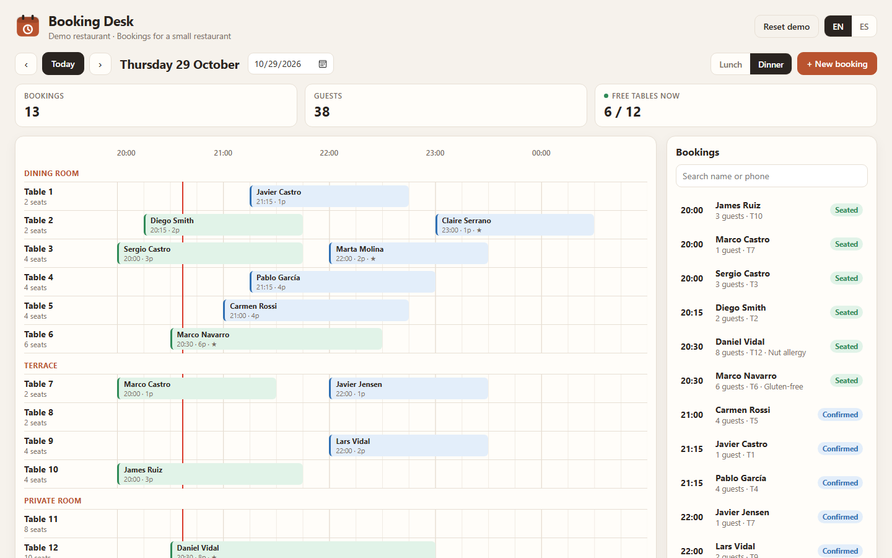
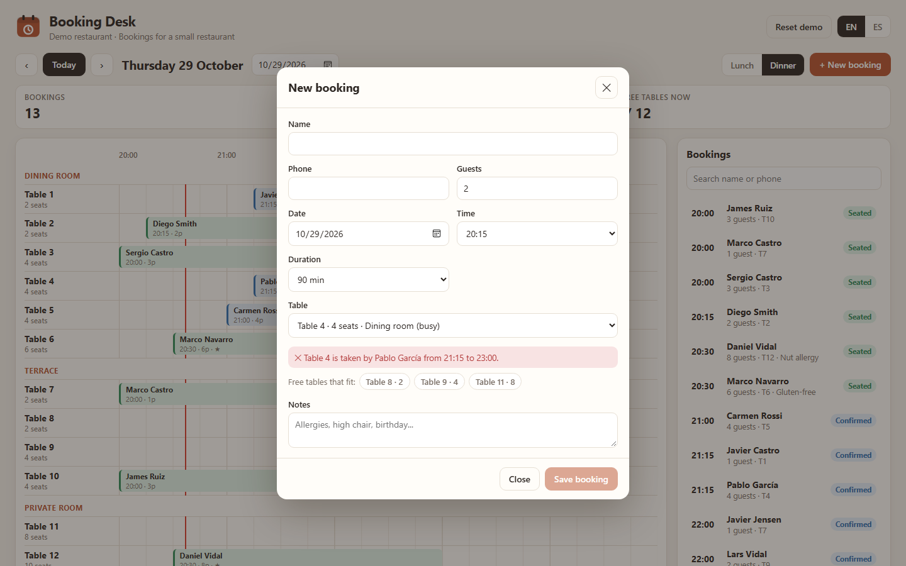
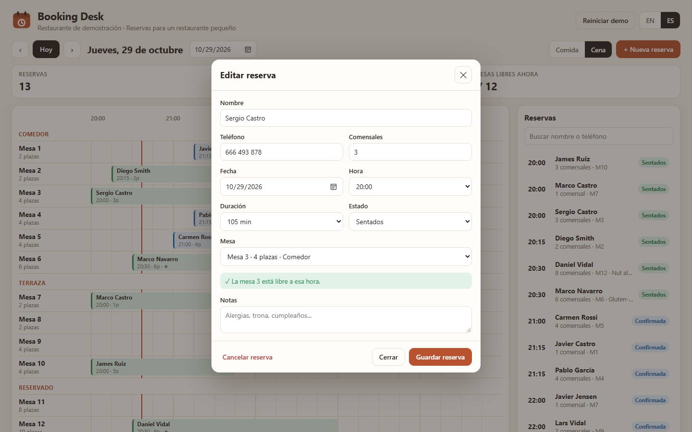
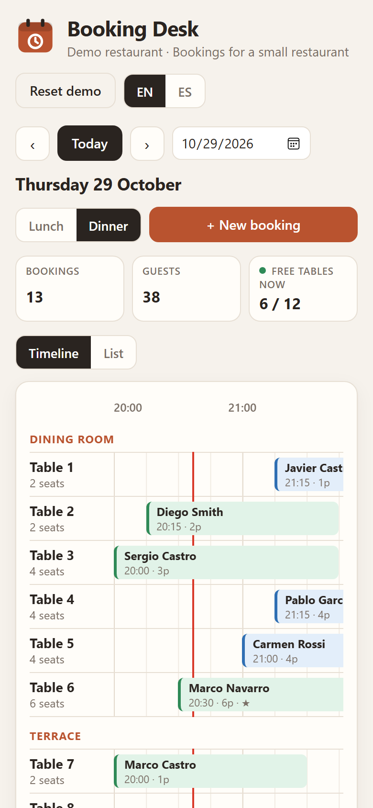
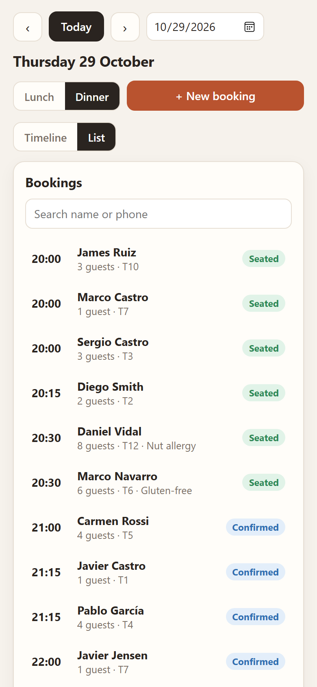

# Booking Desk

A small restaurant doesn't need a big booking platform. It needs to see the evening at a glance, add a booking while the phone is still ringing, and not seat two groups at the same table. That's what I built Booking Desk for: a reservation manager for a restaurant with a dozen tables, made with Angular.

It's a demo, so it runs entirely in your browser. It comes with realistic bookings already filled in around today's date, and everything you change is saved on your device.

**Try it here:** [booking.juancarloscj.com](https://booking.juancarloscj.com)



## What it does

- **A timeline for the whole service.** Each table is a row, grouped by area (dining room, terrace, private room), and each booking is a block from its start time to its end. A red line shows the current time, so you can see which tables are about to free up.
- **Add a booking where it fits.** Click an empty space on any table and the form opens with that table and time already filled in. You can also use the "New booking" button, which suggests the next quarter hour.
- **No double bookings.** If the table is already taken at that time, the form tells you by whom and until when, and won't let you save. It then suggests the free tables that fit the group, smallest first, so a couple doesn't end up on the table for eight. It also warns you if the group is bigger than the table.
- **Sensible defaults.** Bigger groups get more time automatically (90 minutes for two, up to 150 for large groups), unless you pick a duration yourself.
- **Statuses:** confirmed, seated, finished, cancelled and no-show. Cancelling shows an "Undo" button for a few seconds, in case it was a slip.
- **A list view** with search by name or phone, and the cancelled bookings tucked away at the bottom.
- **A quick summary:** bookings and guests for the service, how many tables are free right now, or the busiest time on other days.
- **Lunch and dinner**, any day you like, in **English and Spanish**.
- **It works on phones and tablets.** On smaller screens you switch between the timeline and the list, and the table names stay in place while you scroll the timeline sideways.

| Clash warning | Editing a booking (Spanish) |
|---|---|
|  |  |

| Phone: timeline | Phone: list |
|---|---|
|  |  |

## How I built it

It's **Angular 22** with TypeScript, using the modern way of writing Angular: standalone components, signals for all the state, the new `@if` / `@for` template syntax and no Zone.js. The booking form uses Reactive Forms. There's no UI library; the styles are plain CSS.

I kept the booking rules apart from the screens. Everything that decides something lives in `src/app/core/` as plain functions: whether two bookings overlap, which tables are free, the busiest time, the demo data. That's the part with tests, and the components only display what it returns.

A few things I enjoyed working on:

- **Clashes.** Bookings are treated as half-open time ranges, so a table that frees up at 21:00 can be booked again at 21:00. Cancelled bookings and no-shows don't hold the table.
- **State with signals.** All bookings live in one signal in a small store. The day's bookings, the stats and the free tables are `computed` from it, and an `effect` saves everything to `localStorage` whenever it changes. There's no manual subscribing or refreshing anywhere.
- **Demo data that always looks alive.** The demo bookings are generated with a seeded random generator, so each date always gets the same bookings, with busier Friday and Saturday dinners and quieter Mondays. They're created around today's date, and refreshed on a new day until you change something. Past bookings are finished, and today's are seated or finished depending on the time.
- **A real dialog.** The booking form is a native `<dialog>`, so focus, the Escape key and the backdrop work the way the browser intends.

## Running it locally

You'll need [Node.js](https://nodejs.org) 22.22 or newer (Angular 22's minimum).

```bash
git clone https://github.com/JuanCarlosCJ/booking-desk.git
cd booking-desk
npm install
npm start
```

Then open http://localhost:4200.

| Command | What it does |
|---|---|
| `npm start` | Starts the development server |
| `npm run build` | Builds the site into `dist/booking-desk/browser/` |
| `npm test` | Runs the tests (Vitest) |

## Project structure

```
src/app/
  core/                 the logic, no screens
    models.ts           bookings, tables, services
    config.ts           the tables, opening hours, durations
    time.ts             dates, times and 15-minute slots
    availability.ts     clashes, free tables, stats
    demo-data.ts        the generated demo bookings
    booking.store.ts    all bookings, saved in the browser
    i18n.service.ts     English / Spanish
    texts.ts            all the texts
    core.spec.ts        tests
  timeline/             the day timeline
  booking-list/         the searchable list
  booking-form/         the new / edit booking dialog
  app.ts, app.html      the page: day, service, summary
src/styles.css          all the styles
docs/                   screenshots
```

## Deploying it

`npm run build` creates a static site, so it can be served from anywhere. I upload the contents of `dist/booking-desk/browser/` to a subdomain on my server, which handles HTTPS.

## License

[MIT](LICENSE) © Juan Carlos
